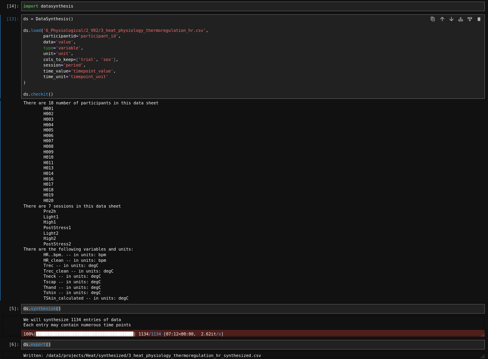

# Update 11/11/2026
This started as a means to perform data synthesis; see UseDataSynthesis.ipynb. This ran on all of our QUT data and it filled up th directory called 'synthesized'. You make not have this in this repository, but all the files in synthesized in the 'public' on the website. As a subfolder, i now also made 'models'. In models you will see buildmodels.py - all the stuff containing 'reading' a table according to the rules outlined below; and the plotting functions. There's also ExploreData.ipynb, and ExploreData-Timeseries.ipynb.

To set things up, download the miniconda installer (anaconda is bloat).
`https://www.anaconda.com/docs/getting-started/installation`
I like the command-line installer, which provides you with 'anaconda shell', and 'anaconda powershell'
The idea is to use the installation commands below to set up your python environment.
Set it up with python=3.11 if you want to use pudb for debugging things.

Then clone the github repository, change-dir into the 'datasynthesis', start up jupyter lab, and navigate to 'models' directory.
There you'll see the .ipynb notebooks that do the plots.

The grand goal is to make a sort of digital twin, which in my view is like a 'model with some predictive value for its intended purpose'. What to predict could be e.g. a behavioral outcome, which is affected by the thing that is done to the participants (e.g. the intervention). We can predict correlations (e.g. what, of all the things we measured at baseline, is correlating with the outcome after the intervention?) - or we can predict single-subject outcomes (what, of all the things we measured from the subject at the baseline/start, will tell us if they are going to 'make' it, or they are going to 'break', after the intervention)? This is just the starting point; a simple logistical (i.e. True/False) model we can train on the data. We could get started with that, so we have something to show. We could do more sophisticated models later to try to find out what happens more locally in the body, or the brain, before, or after the interventions.

In order to figure out what to put into the model, and what kinds of behavioral outcomes are actually changing, we need some inspiration so we can make better choices what to put in. Just putting in everything won't do us any good. To gain inspiration, eyeballing the data is crucial, and having a good eyeballing tool is quite nice. I tried to do justice to whatever could be in the data; i.e. all the individual data points; a box plot; and the distribution.
That is `m.visualize_distributions()`. For each timepoint/conditions, it plots the data. (e.g. at times T1; T2; T3, etc). In order to check whether the intervention did anything at all, I made the `m.visualize_differences`. For each difference, it plots that difference (e.g. T2-T1; T3-T2; etc). Proper order of the conditions is needed). I plot also the zero as a dashed line. 

My hope is that by exploring what is there in the data across different sites, w.r.t. behavioral, or other outcome markers, in terms of changes after intervention (to be looked at with `visualize_differences`), we could find something - an outcome measure - for the model to predict. Then we have our <B>Y</B>. We just need some <B>X</B>, which could be data we see either before the intervention or possibly after. But mostly before.

If the table is structured according to this this:

.. then it should not matter what kind of data, what kind of unit, it is in - one should be able to explore what is in the data.

A note on the code 'beautifulness'(or lack thereof) - I am not a real/proper programmer. This is more intended as an example of what a data exploration could look like - the result is what matters more than the fidelity of the code. I don't have proper logging, code coverage, tests, etc. IF this is something to be developed, that probably needs to be added.

Another note about the visualizations. Since they are made with plotly, I believe they can also be put in a 'Dash', e.g. an on-line exploration tool. If they look visually appealing, it might perhaps convince certain stakeholders. 

If you need anything from me to get this running, please let me know! I've not yet deployed this outside of my own computer, so I might have missed something.


# Update
I've made changes to the UseDataSynthesis notebook to convert a whole batch of files, and to the datasynthesis.py file to solve some issues generating data
One of the checks which 'hung' things was how much percentage of data each subject has. If a subject has NO data whatsoever, it'll not be considered for data modeling. BUT - there is numerical and there is categorical data. Categorical data is never used, and once percentage categorical > numerical, then subject might be thrown out which should not have been. This is now fixed.

Another issue is regardign debugging. I use pudb, and use remote terminal to look at code. BUT - python 3.12 and higher don't work very well. 
Therefore, conda environments (or at least, those that need debugging) are ideally python=3.11. This is not very future-proof.


# Conda
Here some installation instructions to set up your conda environment.
Better to use miniconda - install what you need, and not the bloaty anaconda installer

```python
conda config --add channels conda-forge
conda create -n shield python=3.11
conda activate shield
   
conda install scikit-learn matplotlib jupyterlab
conda install numpy pandas
conda install python-kaleido # not needed for synthesis, but for our other module - data exploration and model creation
conda install anywidget    # same

pip install pudb  # the debugger
pip install tqdm  # the progress bar
```


# Data Synthesis
This is small python module to create a synthesized version of existing participant data for upload with collaborators. This will not share any of the existing data itself. The synthesized data will ideally allow the development of models and data analysis methods that would in the end also be suited to use on the actual existing data.

In addition, the module already lays a small foundation to come to a consensus about how data should ideally look like, across different instututions. 

# Synthesis procedure
This module can load in a .csv data file, in long format, and it will read and create an identical copy of the input data sctructure. Ever cell of the output structure is filled with pandas NA. Then, the actual data file is read in, particiant ID's are randomized, and new data will be generated based on some averages of the existing data. Within the synthesized data, Within-subject variance and between-subject variance are maintained.

With time-series data, we rely on a model that uses phase randomization of the original timeseries to synthesize new timeseries with similar attributes. With Single-entry data (possibly combined with categorical data), we keep the categorical data constant (as this usually has no information in it anyway), and the entries are analyzed. A PCA model is fit and we will impute/synthesize data that maintains the origoinal's session/measure covariance. - basically by putting that all into a single vector for each participant before PCA analysis.


# Bookkeeping
- This module works on long-format data; we also do have matrix-format data. In order to handle that, I'll write a matrix-to-long format (and back again) converter. We can then extend this functions to handle data from other sites.
- A useful feature (see below screenshots) - is that it can output what is IN the data to begin with.

# Python Requirements
- numpy
- scipy
- pudb - pip install pudb - for debugging
- tqdm - pip install tqdm - the progress bar


# how to use
This works on long-format data; i.e. each value of each measurement is 1 complete row. There is also 'normal', or matrix format, but I will write something to convert matrix to long format and back again to help out.

You need to know:
- the full path to the file (or relative to where you use python)
- the column name where participant id's are stored
- the column where the data values are
- the column where the variable TYPE is 
- the column where the variable UNIT is 
- cols_to_keep - can be empty, but allow you to specify which other columns should be copied into the synthesized output; best not to use identifiable columns here.
- the column where the session is (i.e. time point 1, 2, pre, post, etc etc). Can also be NA
- the column where time values are
- the column where time units are

The python module needs all of this to know where the participant numbers, sessions, and data types are; and what to look for. If there is one spelling error, it'll hang.


```python
import datasynthesis

ds = datasynthesis.DataSynthesis(seed=1)

ds.load('6_Physiological/2_V02/3_heat_physiology_thermoregulation_hr.csv',
        participantid='participant_id',
        data='value',
        type='variable',
        unit='unit',
        cols_to_keep=['trial', 'sex'],
        session='period',
        time_value='timepoint_value',
        time_unit='timepoint_unit')
        
ds.checkit()
        
ds.synthesize()

ds.export()
```



